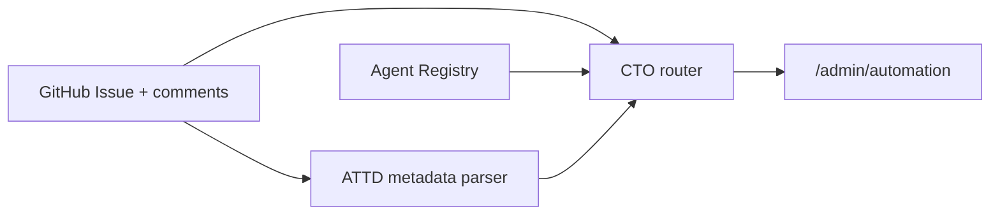

# VNC Agent OS — Phase G1 foundation

**VNC Agent OS** is the existing Agent OS module inside **VNC OS** (see `docs/vnc-os-architecture.md`). Do not build a second Agent OS.

Phase G1 adds a **code-only Agent Registry**, conservative GitHub issue metadata parsing, a pure **CTO routing layer**, and read-only **VNC Agent OS** surfaces on `/admin/automation`. It reuses the existing F1/F2 software factory (GitHub issues, BUILD_APPROVED gate, orchestrator queue, automation dashboard) without database migrations or business-logic changes.

Related docs:

- `docs/vnc-os-architecture.md` (platform SSOT)
- `docs/github-task-status.md` (F1a task status)
- `docs/github-build-orchestrator.md` (F1b orchestrator)
- `docs/github-automation-dashboard.md` (F2 dashboard)
- `AGENTS.md` (engineering and safety rules)

## Architecture (G1)



- **Source of truth:** GitHub issues remain the engineering task system in G1.
- **No writes:** The router does not post comments, labels, or spawn external processes.
- **No secrets:** Agent contracts never store model credentials or tokens.

## Agent Registry

Server-side typed contracts live in `src/features/agent-os/agent-registry.ts` for:

| Agent ID | Role |
| --- | --- |
| `ATTD_CTO` | Orchestrator / routing authority |
| `CRM_AGENT` | CRM & lead/sales |
| `PRICING_QUOTATION_AGENT` | Quotation workflows (Pricing Engine reuse) |
| `PUBLIC_WEBSITE_AGENT` | Public site & admin mobile UX |
| `SEO_AGENT` | Marketing / content / SEO |
| `QA_AGENT` | Tests & CI verification |
| `DEPLOYMENT_AGENT` | Preview / release checklists (no auto deploy) |
| `RELIABILITY_AGENT` | Stability & incident support |

Each contract defines: id, display name, role, mission, allowed task areas, capabilities, forbidden scopes, escalation rules, default priority, and active flag.

## Issue metadata convention

Backward-compatible markers in the **issue body** and/or **comments** (later lines override earlier ones):

```text
ATTD_AGENT: PUBLIC_WEBSITE_AGENT
ATTD_AREA: Public Website UI
ATTD_PRIORITY: P1
ATTD_PARENT_TASK: #123
```

Canonical `ATTD_AREA` values match lane labels or ids from `src/features/automation/automation-lane.constants.ts`, for example:

- `Public Website UI` or `public-website-ui`
- `Lead & Sales / CRM` or `lead-sales-crm`
- `Quotation / Quote Builder` or `quotation-quote-builder`
- `Automation Platform` or `automation-platform`

- Issues **without** these markers behave as before (routing uses TASK_AREA comments, risk labels, and conservative keyword fallback).
- `TASK_AREA:` comments continue to drive lane board classification (`docs/github-automation-dashboard.md`).
- Invalid `ATTD_AGENT` values are ignored (no throw); routing falls through.
- Valid `ATTD_AGENT` overrides that do not match the agent’s allowed task areas still display the override with a mismatch flag on the dashboard.
- `ATTD_AGENT` ids are matched case-insensitively (normalized to uppercase registry ids).

## Routing precedence

Implemented in `src/features/agent-os/agent-router.ts`:

1. **High-risk escalation** → `ATTD_CTO` with human escalation (`risk:high` label and/or conservative high-risk domain keywords). Overrides invalid or valid `ATTD_AGENT` when risk applies.
2. **Valid `ATTD_AGENT` override** when the agent is active (mismatch with allowed task areas is flagged, not silently hidden).
3. **Task area** — canonical lane mapping from TASK_AREA / `ATTD_AREA` context.
4. **Keyword fallback** on title/body/comments (last resort).
5. **Default** → `ATTD_CTO`.

High-risk domains align with `AGENTS.md` (pricing, payment, banking, auth, permissions, invoices, accounting, destructive migrations, etc.).

**Human escalation hints (G1 display-only):** Tasks show “Cần leo thang con người” when routed via high-risk escalation, when the issue lacks `risk:low`, or when the effective task area is the quotation/pricing lane — matching factory safety gates in `docs/github-build-orchestrator.md` without changing orchestrator behavior in G1.

## Dashboard integration

`/admin/automation` (F2) now also shows:

- Assigned agent per task (with escalation hint when required)
- Display task area (`ATTD_AREA` when set, else TASK_AREA)
- Priority and parent task when metadata is present
- Agent summary cards: open-task counts per agent (active / blocked / queued)

Authorization, GitHub read tokens, and caching behavior are unchanged. No client-side token exposure.

## Safety boundaries (G1)

- Preserves **one active Builder** queue and **BUILD_APPROVED** authorization.
- No automatic merge, deploy, or agent-spawned shell processes.
- No Prisma schema changes or production database writes from VNC Agent OS code paths.
- Does not modify pricing, payment, banking, auth, or permission **business logic**.

## Phase G2 — persistent execution state

G2 adds **additive Prisma models** and server services for durable agent execution history. GitHub remains the engineering source of truth; the database stores run state, events, and decisions (summaries only — no secrets).

### Models

- `AgentRun` — top-level execution attempt with status, blocker, next action, human approval markers, correlation/parent retry chain, idempotency key.
- `TaskRun` — optional sub-run scoped to an `AgentRun` (issue linkage, task area).
- `AgentEvent` — idempotent inbound events (`AgentEventSource` enum).
- `AgentDecision` — structured decision log with risk level and evidence references.

### State machine

Typed statuses: `QUEUED → RUNNING → WAITING_EXTERNAL | WAITING_HUMAN → SUCCEEDED | FAILED | CANCELLED`.

Implementation: `src/features/agent-os/agent-run.state-machine.ts` (terminal-state protection, deterministic transitions). Retries create a **new** `AgentRun` row with incremented `attemptNumber` and `parentRunId` — history is never overwritten.

### Event ingestion boundary

Pure normalizers in `src/features/agent-os/agent-event.ingestion.ts` for GitHub issue status, PR, CI, reviewer, Vercel deployment, and manual owner decisions. G3 will wire these to live webhooks/pollers; G2 exposes `applyInboundAgentEvent` in `agent-run.service.ts`.

### Admin visibility

`/admin/automation` task details include **VNC Agent OS — lịch sử chạy (G2)** via `GET /api/admin/automation/agent-runs?issueNumber=…` (same `dashboard.view` permission as the dashboard).

### Migration safety

Migration `0099_agent_os_g2_persistence` is additive only (new enums/tables). Rollback: drop the four tables and enums in reverse order on a non-production database; no backfill required.

## Future phases

- **G3:** CTO event loop with safe automatic assignment and guarded actions.
- **G4:** Specialist agents + QA / deployment / reliability closed loop.
